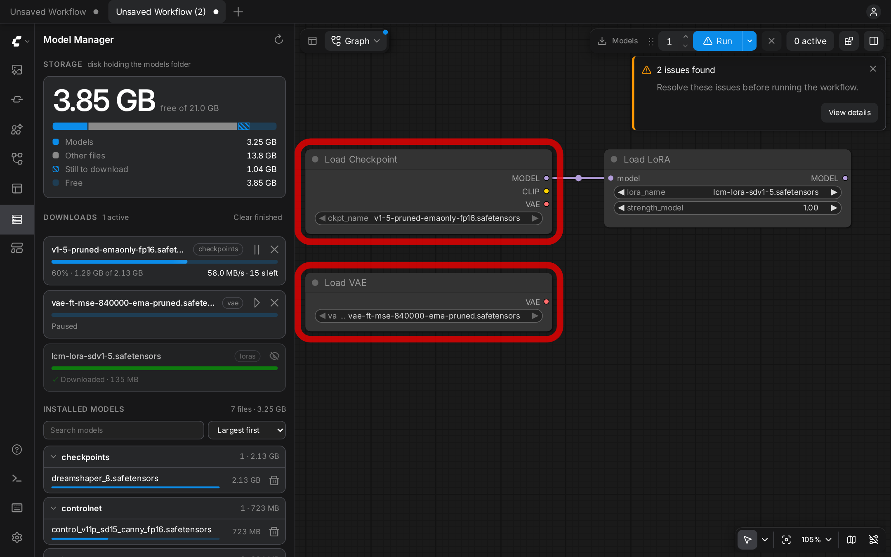
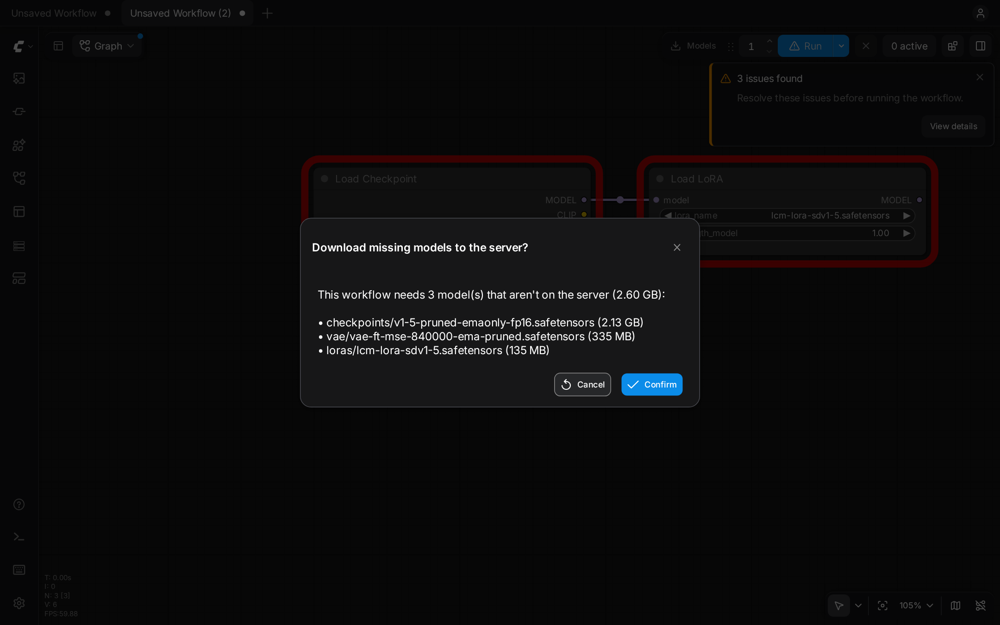
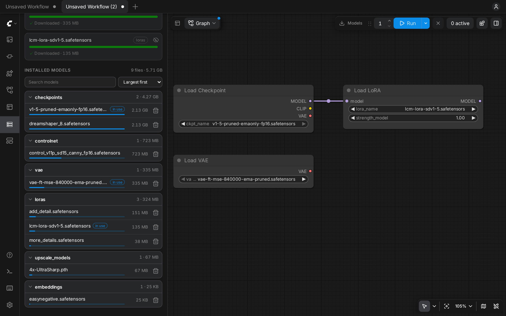

# mycomfyui

[](https://github.com/clems4ever/mycomfyui/actions/workflows/ci.yml)

[ComfyUI](https://github.com/comfyanonymous/ComfyUI) in Docker for NVIDIA GPUs, with
ComfyUI-Manager and a **Model Manager** panel: download a workflow's models straight to
the server, follow the downloads live, and keep an eye on disk space.



## Run it

Needs an NVIDIA driver and the
[NVIDIA Container Toolkit](https://docs.nvidia.com/datacenter/cloud-native/container-toolkit/latest/install-guide.html).

```sh
docker compose up -d
```

Then open http://localhost:8188. Models, outputs and settings are kept in `./data`.

To skip the build, use the published image: set `image: ghcr.io/clems4ever/mycomfyui:latest`
instead of `build: .` in `docker-compose.yml`.

## Model Manager

Open a workflow with missing models and it offers to download them to the server:



Downloads can be paused, resumed and cancelled, and pick up where they left off after a
restart. Installed models are listed by folder, with the ones the open workflow uses
marked **in use**, and can be deleted to free space:



For gated models (e.g. FLUX.1-dev), put `HF_TOKEN=hf_...` in a `.env` file next to
`docker-compose.yml`.

> [!WARNING]
> Anyone who can reach port 8188 can install custom nodes and download or delete models.
> Keep it on a trusted network.

## License

[MIT](LICENSE)
